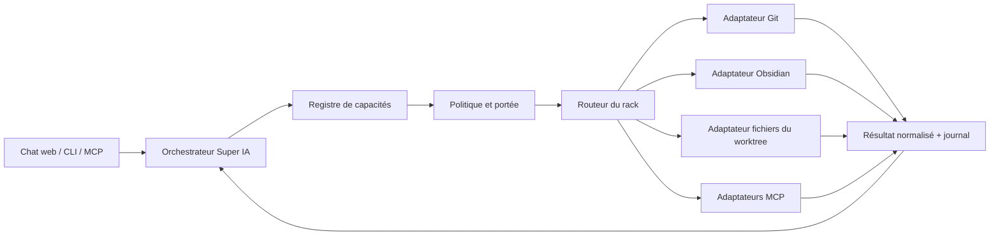

# Architecture cible : rack logiciel

## Décision

Le concept est réalisable et correspond au besoin du projet. Le système doit
présenter les logiciels comme des modules raccordables à des capacités
communes, à la manière d’un rack audio : on installe ou active un module, on
relie ses sorties à des usages, puis on choisit quels usages chaque agent peut
recevoir.

Le rack ne doit pas devenir un nouveau catalogue parallèle. Il unifie les
capacités et les permissions ; les adaptateurs existants continuent de parler
aux outils réels.

MCP peut servir de protocole de raccordement pour certains modules, comme
d’autres modules utilisent une API, une CLI ou un adaptateur natif. Il ne
remplace ni le registre du rack ni son routeur. L’étude détaillée est dans
[`ETUDE_MCP_SUPERIA.md`](ETUDE_MCP_SUPERIA.md).

## État observé

- Les fournisseurs IA sont décrits dans `src/providers/catalog.ts`.
- Les connexions logiciels, MCP, SSH et CLI sont décrites dans
  `src/connections/catalog.ts` et leur registre privé.
- Les outils du chat local (`list_files`, `read_file`, `write_file`) sont
  encore déclarés à part dans `src/web/server.ts`.
- La console web et la CLI ont des points d’entrée différents.

Les catalogues ont des responsabilités utiles, mais aucune couche commune ne
décrit encore qu’un logiciel « Git », un serveur MCP et le chat local peuvent
tous fournir une capacité sémantique `fichiers.lire`. Cette couche commune est
le manque architectural à traiter.

## Vocabulaire du rack

| Élément | Rôle | Exemple |
| --- | --- | --- |
| Module | Logiciel ou service installé | Ollama, Git, Obsidian, serveur MCP |
| Adaptateur | Parle le protocole du module | API Ollama, CLI Git, MCP stdio |
| Capacité | Action stable comprise par le système | `fichiers.lire`, `notes.rechercher`, `git.diff` |
| Ressource | Objet sur lequel agit une capacité | Worktree courant, coffre Obsidian |
| Rack | Composition activée pour un projet ou un agent | Atelier de code local |
| Route | Choisit quel adaptateur fournit une capacité | `notes.rechercher` → adaptateur Obsidian |
| Permission | Limite les actions et la portée | lecture du worktree, écriture dans Inbox |

Un module peut fournir plusieurs capacités. Une capacité peut avoir plusieurs
modules fournisseurs, mais une requête donnée doit être routée vers un seul
fournisseur à la fois, sauf comparaison explicitement demandée.

## Vue d’ensemble



## Contrat d’une capacité

Chaque capacité expose un identifiant stable, un schéma d’entrée et de sortie,
les ressources autorisées, son niveau de risque, ses exigences d’approbation,
son délai maximal et son comportement en cas de nouvelle tentative. Le nom du
logiciel ou son protocole ne doit pas apparaître dans le prompt du modèle si la
capacité est identique.

Exemple conceptuel :

```json
{
  "id": "fichiers.lire",
  "version": 1,
  "input": { "path": "string" },
  "output": { "content": "string", "truncated": "boolean" },
  "risk": "read",
  "scope": "worktree-courant",
  "approval": "never",
  "providers": ["workspace-native", "mcp-files-readonly"]
}
```

`CHAT_TOOLS` reste le catalogue du chat, et son extraction en registre partagé
chat/CLI reste à faire. Trois outils du chat local appellent maintenant les
capacités de lecture MU-TH-UR : inventaire Ollama, recherche dans les articles
en cache et état de santé Quant Core. Les capacités sont mappées vers des URLs
fixes côté serveur; le modèle ne peut choisir ni destination ni action
arbitraire. Écritures Obsidian, commandes système, rafraîchissement des flux et
actions de trading ne sont pas exposées par ce pont. Il requiert Veille sur
`127.0.0.1:8765`; son indisponibilité apparaît comme un échec d’outil.

La prochaine étape consiste à extraire ce contrat et son exécuteur en un
service réutilisable par le chat, la CLI, les workflows et ensuite MCP.

## Déduplication et raccordement

La déduplication se fait par capacité et ressource, pas seulement par nom de
logiciel. Par exemple, plusieurs modules peuvent savoir lire un fichier, mais
le rack les raccorde au même port `fichiers.lire`. Le choix de l’adaptateur
dépend de la ressource : worktree courant, dépôt distant ou coffre Obsidian.

Le registre doit distinguer :

- **doublon d’interface** : plusieurs logiciels exposent la même action sur la
  même ressource ; le rack choisit une route principale et peut garder un
  secours compatible ;
- **capacité voisine** : actions proches mais sémantiquement différentes,
  comme `fichiers.rechercher` et `notes.rechercher` ; elles restent séparées ;
- **complément** : deux modules nécessaires à un flux, comme rechercher une
  note Obsidian puis enregistrer un brouillon dans son Inbox.

La configuration d’un rack référence des identifiants de modules et de
capacités, jamais des commandes shell arbitraires ni des secrets.

## Profils de permission

Le modèle propose une action ; le rack et sa politique décident si elle est
possible :

1. **Observer** — statut, liste et recherche en lecture seule.
2. **Lire** — contenu borné dans une ressource autorisée.
3. **Préparer une modification** — diff ou brouillon explicite.
4. **Écrire** — uniquement dans une portée déclarée, avec trace et règle
   d’approbation adaptée.
5. **Exécuter** — commandes dans un worktree isolé, via le runner existant,
   avec timeout, sandbox, budget et vérifications.
6. **Réseau ou dépense** — désactivé par défaut, destination et budget
   explicites.

« Débrider au maximum » signifie rendre les capacités disponibles et annoncer
clairement leurs limites, pas supprimer les portées de fichiers, la sandbox,
les budgets ou l’approbation humaine déjà définis par Super IA.

## Intégration progressive

1. Inventorier les modules, leurs capacités, ressources et permissions sans
   changer leur comportement.
2. Définir des identifiants canoniques et repérer les doublons.
3. Extraire l’exécution des outils du chat dans un `CapabilityRegistry` local.
4. Faire consommer le même registre au chat et à la CLI.
5. Ajouter les profils de rack par projet, puis une interface de raccordement.
6. Ajouter les adaptateurs MCP et les modules externes après revue de leurs
   permissions et de leurs sources.

Chaque étape doit garder des adaptateurs directs utilisables pendant la
migration. Aucun module découvert n’est activé ou autorisé automatiquement.

## Critères d’acceptation du premier rack

- une capacité a la même entrée, la même sortie et la même règle de sécurité
  depuis le chat et la CLI ;
- un doublon de capacité est visible et possède une route explicite ;
- une ressource n’est pas mélangée avec une autre (worktree, coffre, dépôt
  distant) ;
- les résultats et erreurs sont journalisés sans secrets ;
- une capacité d’écriture produit une trace exploitable ;
- les capacités d’exécution, réseau et dépense gardent leurs garde-fous ;
- un rack incomplet indique exactement quel module ou permission manque.

## Ce qui n’est pas encore décidé

- la représentation persistante des racks et leur portée (machine, projet,
  agent) ;
- si un module fournit directement une capacité ou passe par un processus
  worker isolé ;
- la stratégie de sélection entre deux fournisseurs compatibles ;
- les changements qui exigent confirmation à chaque appel ou par session ;
- l’exposition éventuelle du registre en MCP.

Ces choix doivent suivre l’inventaire et le prototype du registre, pas précéder
la vérification des capacités réelles.
