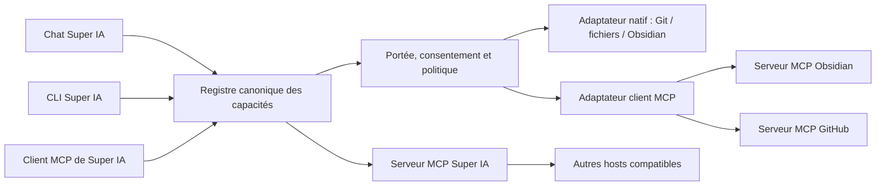

# Étude MCP pour Super IA et le rack logiciel

Date de revue : 12 novembre 2026  
Révision MCP examinée : `2026-07-28`.

## Résumé pour Azoth

MCP peut raccorder des logiciels à des assistants compatibles par une
interface commune. Un serveur MCP peut proposer des **outils** que le modèle
appelle, des **ressources** que l’application charge comme contexte, et des
**prompts** réutilisables. Le protocole standardise la découverte et les appels
JSON-RPC ; il ne fournit ni le logiciel raccordé, ni le modèle, ni le moteur de
workflow.

Pour le rack logiciel, MCP joue le rôle d’un type de prise et de câble. Le rack
reste la couche Super IA qui décrit les modules, les ressources, les capacités,
les routes et les permissions. MCP est une des façons de raccorder un module ;
les API natives, les CLI et les adaptateurs Super IA restent d’autres façons.

Il faut distinguer deux fonctions différentes :

1. **Super IA client MCP (host)** : Super IA découvre et appelle les capacités
   d’autres serveurs, par exemple un connecteur documentaire ou GitHub. C’est
   cette fonction qui rendrait ces outils accessibles au chat Super IA.
2. **Super IA serveur MCP** : Super IA expose ses propres capacités à des
   assistants externes compatibles. Cela peut rendre les projets, diagnostics
   et tâches Super IA utilisables depuis ces assistants.

Un serveur MCP seul ne donne donc pas au chat Super IA l’accès aux serveurs
MCP externes. Il faut un client MCP dans le host qui pilote ce chat.

## Ce que cela peut apporter au système

- **Réutiliser des connecteurs** : consommer une intégration MCP existante au
  lieu d’écrire un connecteur particulier pour chaque interface IA.
- **Rendre les outils découvrables** : le client peut demander la liste et les
  schémas des outils, puis appeler une capacité normalisée.
- **Partager du contexte** : charger des ressources documentaires ou des
  résultats structurés sans transformer tout le logiciel source en plugin.
- **Proposer des commandes réutilisables** : offrir des prompts de travail
  prédéfinis, par exemple « résumer cette note » ou « préparer une revue ».
- **Faire dialoguer plusieurs clients** : une capacité raccordée peut être
  accessible depuis différents hosts compatibles, sous réserve de leurs
  clients MCP et règles de consentement.
- **Mieux composer les workflows** : une recherche documentaire, une lecture
  Git et une création de brouillon peuvent former un flux si chaque module
  expose une capacité définie et si Super IA orchestre l’ordre.

Exemples pertinents à étudier pour Azoth : notes Obsidian, recherche et lecture
de dépôts, issues et pull requests GitHub, opérations autorisées sur un
workflow N8N, et recherche documentaire. Chaque serveur devrait être choisi
selon ses capacités réelles et ses permissions, pas seulement parce qu’il
porte l’étiquette MCP.

## Ce que MCP n’apporte pas à lui seul

- Il ne rend pas un modèle plus intelligent et ne corrige pas ses réponses.
- Il ne lance pas une application qui n’a pas de serveur ou d’adaptateur.
- Il ne décide pas si un outil est sûr, autorisé ou adapté au projet.
- Il ne remplace pas le registre, les tâches, le routeur, les budgets ou le
  contrôle d’exécution de Super IA.
- Il ne rend pas automatiquement le chat web, la CLI Mistral ou un autre client
  compatible ; chacun doit intégrer un client MCP.

MCP ne doit donc pas devenir la base du système ni un second moteur métier. Il
normalise les échanges avec certains modules du rack.

## État réel du dépôt Super IA

Les fichiers suivants déclarent des types de connexion MCP :

- `src/connections/types.ts` : types `mcp-stdio` et `mcp-http` ;
- `src/connections/store.ts` : validation et inspection statique de ces
  connexions ;
- `src/connections/cli.ts` et `docs/CONNECTIONS.md` : ajout et documentation
  de déclarations de connexion.

À la date de cette étude, l’audit n’a trouvé ni dépendance MCP dans
`package.json`, ni client MCP, ni lancement d’un handshake, ni découverte
`tools/list`, `resources/list` ou `prompts/list`, ni appel `tools/call`.
`superia connection doctor` vérifie une commande, une URL et les variables
d’environnement déclarées ; il ne confirme pas que le protocole MCP fonctionne.
La sonde HTTP générique utilise `HEAD`, pas une requête MCP.

Les appels `list_files`, `read_file`, `write_file` et les trois outils
`mother_*` du chat local sont des outils natifs déclarés dans
`src/web/server.ts`, pas des outils MCP. Les outils `mother_*` appellent le
registre MU-TH-UR via un pont local en lecture seule. Les types de connexion
enregistrés aujourd’hui restent des **métadonnées de catalogue**, pas une
intégration MCP opérationnelle.

## Pilote Obsidian : faisabilité et ordre de réalisation

Un serveur MCP Super IA spécialisé Obsidian est faisable sur cette machine en
transport `stdio`. Le SDK TypeScript officiel actuel fournit un serveur dédié
et le transport `serveStdio`; le protocole circule sur les pipes locaux, sans
ouvrir un port LAN. Il faut toutefois distinguer deux livrables :

1. le **serveur Obsidian MCP**, qui rend les capacités accessibles aux autres
   hôtes compatibles ;
2. le **client MCP dans Super IA**, seul moyen pour le chat Super IA lui-même
   de découvrir et d’appeler ce serveur.

Créer seulement le serveur ne rendrait donc pas l’outil visible dans notre chat.
L’intégration actuelle possède déjà recherche contextuelle locale, recherche
de notes et création de brouillons dans `Inbox/`, mais elle utilise des routes
et fonctions natives, pas MCP. Le bon pilote consiste à extraire d’abord ces
opérations dans un service Obsidian partagé, puis à y brancher une façade MCP
`stdio` et, séparément, le client MCP du chat. Cela évite deux implémentations
des permissions et des chemins.

Capacités du premier pilote : `obsidian.search`, `obsidian.read` (contenu
borné), et `obsidian.create_draft` (création exclusive dans `Inbox/`). Pas de
remplacement, suppression, commande shell, accès aux fichiers cachés, secrets
ou exposition du coffre complet comme ressource par défaut. Les retours du
serveur sont des données non fiables et les sources restent citées par chemin.

La synchronisation du coffre est un chantier distinct du MCP. Le montage rclone
Linux observé pointe vers Google Drive avec cache VFS ; ce n’est pas un miroir
hors ligne ni une synchronisation directe sur le LAN. Syncthing peut synchroniser
des pairs présents sur le Wi-Fi local, mais ajouter une deuxième synchronisation
bidirectionnelle sur le même coffre Drive créerait deux autorités concurrentes.
Avant activation, choisir Drive ou Syncthing comme mécanisme d’écriture unique,
recenser les chemins locaux de chaque appareil, tester sur une copie et activer
le versionnement Syncthing (qui n’est pas activé par défaut).

Références officielles actuelles :

- [SDK MCP TypeScript v2 : serveur MCP](https://ts.sdk.modelcontextprotocol.io/v2/)
- [SDK MCP TypeScript : service `stdio`](https://ts.sdk.modelcontextprotocol.io/v2/serving/stdio)
- [Syncthing : conservation des anciennes versions](https://docs.syncthing.net/users/versioning.html)
- [Syncthing : découverte locale sur le réseau](https://docs.syncthing.net/users/config.html)

## Fit dans l’architecture rack

Les outils MCP découverts ne devraient pas être injectés directement dans les
modèles sans contrôle. Le registre Super IA doit d’abord les convertir en
capacités canoniques, vérifier les schémas et filtrer ceux que le rack autorise
pour le projet, l’utilisateur et la session. Les noms peuvent ensuite être
qualifiés (`github.issue.read`, `obsidian.note.search`) pour éviter les
collisions.

La déduplication se fait sur le triplet **capacité + ressource + portée**.
`fichiers.lire` dans le worktree courant et `github.fichier.lire` dans un dépôt
distants sont proches mais ne sont pas la même ressource. Plusieurs adaptateurs
peuvent fournir une capacité compatible ; le routeur choisit une route explicite
et ne contacte pas les deux par surprise.

## Transports et choix pratique

La révision examinée sépare le protocole JSON-RPC et le transport :

- **stdio local** : Super IA lance un processus local et dialogue avec lui.
  C’est le meilleur premier essai pour un serveur local approuvé, sans ouvrir
  de port réseau. Le processus et son environnement restent néanmoins une
  frontière de confiance.
- **Streamable HTTP** : utile pour un serveur partagé ou distant. Il faut alors
  authentification adaptée, contrôle de destination, validation TLS, durée
  maximale, gestion des redirections et protection SSRF.

La spécification `2026-07-28` utilise des requêtes stateless avec découverte
`server/discover` et métadonnées par requête. Des serveurs et clients plus
anciens utilisent le cycle avec `initialize`. Un futur client Super IA doit
négocier ou épingler une révision supportée, journaliser la version choisie et
tester la compatibilité ; le champ `protocolVersion` stocké dans le registre
ne réalise pas cette négociation.

## Sécurité et confiance

MCP transporte des actions possibles ; il n’impose pas à lui seul une politique
Super IA. La documentation officielle recommande une visibilité claire des
outils et une capacité humaine à refuser les appels. Les descriptions et
résultats fournis par un serveur doivent être traités comme des données non
fiables, car ils peuvent contenir des instructions malveillantes.

Règles proposées pour le rack :

1. connexion et inventaire désactivés par défaut ; revue des sources et versions
   avant activation ;
2. afficher chaque outil découvert, sa description, ses effets et sa portée ;
3. appliquer le consentement au niveau utilisateur/session et une capacité
   humaine de refus ; préautoriser seulement les lectures bornées et comprises ;
4. demander confirmation aux écritures, suppressions, exécutions ou actions
   externes, avec résumé des arguments et de la cible ;
5. ne jamais donner au modèle les secrets d’authentification ; authentifier
   l’adaptateur et ne jamais transférer aveuglément un token tiers ;
6. restreindre les chemins aux worktrees ou au dossier Inbox explicitement
   configurés ; ne pas transmettre le coffre complet comme ressource par défaut ;
7. limiter taille des entrées/sorties, pagination, durée, nombre d’appels et
   appels simultanés ;
8. conserver un journal expurgé : serveur, outil, ressource, accord/refus,
   durée, statut et empreinte de configuration ;
9. traiter les erreurs et contenus MCP comme non fiables, et ne jamais laisser
   une description d’outil élargir ses propres permissions ;
10. pour stdio, épingler l’exécutable et la version, utiliser une allowlist de
    variables d’environnement et refuser le téléchargement/exécution implicite.

L’étude de sécurité MCP décrit notamment les risques de serveurs locaux
compromis, de confused deputy, de token passthrough, de SSRF et de permissions
trop larges. Ils sont pertinents pour le rack Azoth car celui-ci reliera des
ressources locales, des dépôts et des services distants.

## Recommandation pour Azoth

1. **Ne pas installer un serveur MCP universel avec accès shell et disque.**
2. **Finir le registre canonique du rack** : capacités, ressources, permission,
   risque et adaptateur préféré ; faire consommer ce registre par le chat et la
   CLI.
3. **Créer ensuite un petit client MCP sortant**, d’abord `stdio`, qui peut
   découvrir les outils, les présenter dans l’UI, filtrer avec la politique du
   rack et faire une seule opération à la fois.
4. **Premier pilote** : un serveur documentaire en lecture seule sur un dossier
   explicitement choisi, comparé aux outils Obsidian natifs actuels. Mesurer la
   découverte, les résultats, les erreurs, le chevauchement et les permissions.
5. **Après validation**, exposer les capacités internes Super IA en serveur MCP
   lecture seule (`project.list`, `task.get`, `repository.status`,
   `diagnostic.run`) pour que des hosts externes compatibles puissent les
   interroger.
6. Ajouter les écritures, GitHub/N8N et HTTP distant au cas par cas après les
   tests, l’interface de consentement et les limites de portée.

Le pilote réussit si l’outil apparaît bien côté modèle, si les lectures restent
dans la ressource choisie, si un appel refusé ne produit aucun effet, et si le
chat ainsi que la CLI réutilisent la même capacité Super IA au lieu de créer un
deuxième chemin métier.

## Sources primaires consultées

- [Spécification MCP `2026-07-28`](https://modelcontextprotocol.io/specification/2026-07-28)
- [Architecture officielle MCP](https://modelcontextprotocol.io/docs/2026-07-28/learn/architecture)
- [Concepts de serveurs MCP](https://modelcontextprotocol.io/docs/2026-07-28/learn/server-concepts)
- [Outils MCP](https://modelcontextprotocol.io/specification/2026-07-28/server/tools)
- [Bonnes pratiques de sécurité MCP](https://modelcontextprotocol.io/docs/2026-07-28/tutorials/security/security_best_practices)
- [Changements depuis `2025-11-25`](https://modelcontextprotocol.io/specification/draft/changelog)
